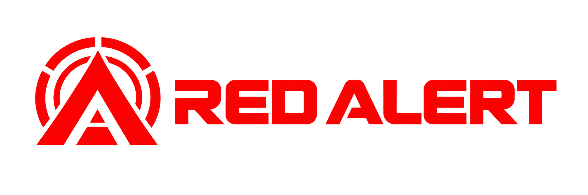

<p align="center">
  
</p>

<p align="center"><strong>Reverse engineering • Web reconnaissance • Defensive security</strong></p>
<p align="center">Workspace keamanan berbasis bukti, dengan CLI, console lokal, dan alur kerja coding agent.</p>

<p align="center">
  <a href="https://github.com/kohryan/red-alert/actions/workflows/security.yml"></a>
  <a href="https://www.python.org/downloads/"></a>
  <a href="LICENSE"></a>
  <a href="#console-web"></a>
  <a href="AGENTS.md"></a>
</p>

# Red Alert

Red Alert membantu menginventarisasi artefak, memetakan permukaan web/API, mengumpulkan dokumen yang diizinkan, dan menyusun temuan beserta buktinya. Tool ini ditujukan untuk sistem milik sendiri atau target dengan izin yang tercatat.

Setiap kesimpulan memakai label **observed**, **derived**, **inferred**, atau **unknown**. Analisis statis tidak dianggap sebagai bukti perilaku runtime; tidak adanya temuan tidak membuktikan sebuah sistem aman.

## Fitur

| Fitur | Kemampuan |
| --- | --- |
| Triage artefak | SHA-256, deteksi ELF/PE/Mach-O/ZIP/WASM, header/section, entropi, dan ekstraksi string tanpa menjalankan sampel. |
| Recon web | Inventaris halaman, aset, endpoint API, source map, header keamanan, indikasi credential, dan file yang dipublikasikan target. |
| Koleksi API | Rekonstruksi surface dari HAR/JSON, validasi spesifikasi, pagination, proyeksi field, deduplikasi, cache kondisional, dan audit request. |
| Ekstraksi dokumen | JSON, GeoJSON, literal JSON pada JavaScript, CSV, teks, serta tabel/konten HTML. Kode JavaScript target tidak dievaluasi. |
| Bukti dan laporan | Dataset JSON, tabel, laporan PDF, coverage, audit JSONL, evidence ledger, dan attack graph. |
| Console web | Daftar target, progres, hasil recon, tabel, graph, dan unduhan JSON/PDF melalui server lokal. |
| Agent opsional | Pemilihan pemeriksaan dari katalog terbatas menggunakan model lokal via Ollama atau endpoint kompatibel OpenAI. Bisa berjalan tanpa model. |
| Audit repo | Scanner pola secret, pemeriksaan hygiene, adapter audit dependency, dan self-test dengan data sintetis. |
| Workflow agent | Skill, agent, perintah Kilo, playbook, template finding, dan aturan bukti dalam repo. |

CVE berdasarkan banner/versi adalah indikasi yang perlu diverifikasi. Attack graph menjelaskan hubungan bukti; sebuah path tidak membuktikan eksploitasi berhasil.

## Prasyarat

- Python **3.10+**, Git, Bash, dan Make; macOS atau Linux.
- Fitur inti dan penulisan PDF menggunakan Python standard library. Tidak perlu `pip install` atau API key untuk penggunaan dasar.
- Browser untuk console lokal. Model lokal dan engine analisis seperti Ghidra/JADX/Frida bersifat opsional.
- `make doctor` menampilkan tool yang tersedia tanpa menginstalnya. `certifi`, bila sudah tersedia, dapat dipakai sebagai sumber CA tambahan saat trust store platform kosong.

## Mulai cepat

```bash
git clone https://github.com/kohryan/red-alert.git
cd red-alert
make bootstrap
make doctor
make baseline
make test
```

`make bootstrap` membuat folder kerja lokal dan `evidence/ledger.md`. Repo private memerlukan akses GitHub saat clone. Jalankan semua perintah dari root repo.

## Console web

```bash
make webapp-serve
# buka http://127.0.0.1:8765
```

Console memakai spesifikasi API sintetis lokal secara default. Menjalankan server saja tidak memindai target. Mulai fixture di Terminal lain untuk mencoba tombol collection:

```bash
python3 examples/api-origin.py --port 8801
```

Untuk memilih folder kerja atau port:

```bash
make webapp-serve WEBAPP_WORK=labs/demo/work PORT=8766
```

Masukkan URL target milik sendiri pada console dan konfirmasi otorisasinya sebelum recon. Endpoint mutasi memerlukan JSON dan menolak Origin asing; Host dibatasi ke alamat server. Console tidak menyediakan akun/login: gunakan alamat loopback dan jangan publikasikan melalui proxy, tunnel, atau interface jaringan bersama.

## Contoh penggunaan

### Triage file secara statis

```bash
make triage FILE=/path/to/artifact
# atau tentukan folder output secara eksplisit:
bash scripts/re/triage.sh /path/to/artifact --out labs/triage-demo/work
make ledger
make report
```

Triage membaca byte dan dapat memanggil parser sistem yang tersedia. Gunakan salinan artefak; sampel yang tidak dipercaya tetap sebaiknya dianalisis di VM/container sekali pakai.

### Koleksi dokumen lokal tanpa target eksternal

Setelah fixture port 8801 berjalan:

```bash
python3 -m webapp validate examples/collection-spec.example.json
python3 -m webapp plan examples/collection-spec.example.json
python3 -m webapp collect examples/collection-spec.example.json \
  --out labs/demo/work --report labs/demo/work/report.pdf
python3 -m webapp report labs/demo/work/dataset.json \
  --out labs/demo/work/report.pdf
```

Contoh mengambil halaman pertama berisi 20 item dan ringkasan yang menyatakan total 137 item. Hasil ini **parsial**; seluruh katalog belum dikoleksi. `validate` dan `plan` tidak mengirim request; `collect` mengirim request ke fixture lokal.

### Rekonstruksi API dari capture

```bash
mkdir -p labs/api-demo
python3 -m pipeline surface examples/capture.example.json \
  --out labs/api-demo/surface-spec.json --report
```

Spesifikasi hasil rekonstruksi belum diotorisasi. Tinjau endpoint, field, batas volume, dan isi `authorization.status`, `scope`, serta `reference` berdasarkan izin yang benar-benar kamu miliki. Sesudah itu:

```bash
python3 -m pipeline validate labs/api-demo/surface-spec.json
python3 -m pipeline plan labs/api-demo/surface-spec.json
python3 -m pipeline run labs/api-demo/surface-spec.json --dry-run
python3 -m pipeline run labs/api-demo/surface-spec.json \
  --out labs/api-demo/work/items.jsonl \
  --audit labs/api-demo/work/audit.jsonl \
  --cache labs/api-demo/work/cache
```

Capture contoh memakai domain `example.invalid` dan placeholder credential. Ganti dengan target berizin sebelum run nyata; jangan menyalin cookie atau token dari capture.

### Recon dan agent untuk target berizin

```bash
python3 -m webapp recon https://target.example \
  --out labs/recon --authorized
# hasil recon ada di labs/recon/recon-cli/
python3 -m webapp agent labs/recon/recon-cli/dataset.json \
  --out labs/agent --authorized
```

`target.example` adalah placeholder. Opsi `--authorized` menyatakan bahwa operator sudah memiliki izin; flag ini tidak memberikan izin. Gunakan cakupan yang disepakati dan perhatikan bahwa recon dapat memeriksa aset, path sensitif, dan host yang ditemukan.

Untuk model lokal yang sudah kamu jalankan, tambahkan pada perintah agent:

```bash
--model-endpoint http://127.0.0.1:11434 --model llama3.1
# server kompatibel OpenAI: tambahkan --model-api openai
```

Ini adalah argumen CLI, bukan perintah tersendiri. Default memakai Ollama; `--allow-remote-model` harus diaktifkan secara eksplisit untuk endpoint nonlokal. Prompt remote memakai profil yang disamarkan, tetapi operator tetap harus meninjau izin pengiriman data. Audit ini tidak menguji koneksi model.

## Konfigurasi dan .env

Aplikasi membaca argumen CLI dan environment proses; **file `.env` tidak dimuat otomatis**. Tidak ada credential bawaan dan tidak ada API key yang diperlukan untuk contoh lokal.

| Pengaturan | Kegunaan |
| --- | --- |
| `RED_ALERT_ACCESS_LOG` | Nilai nonkosong mengaktifkan access log server; kosong/tidak diset menonaktifkannya. Log dapat memuat URL sensitif. |
| `RED_ALERT_MAX_REQUESTS` | Batas request recon; default 190. |
| `RED_ALERT_MIN_INTERVAL` | Jeda minimum recon dalam detik; default 0.4. Tetap hormati batas pemilik dan robots. |
| `SSL_CERT_FILE` | Path CA bundle tepercaya milik operator sebelum Python dijalankan. Sertifikat yang gagal diverifikasi tidak diperbaiki dengan mengambil CA dari target. |
| `WEBAPP_SPEC`, `WEBAPP_WORK`, `PORT` | Variabel Make untuk spesifikasi, folder hasil, dan port console. |
| `MODEL_ENDPOINT`, `MODEL` | Variabel Make untuk `make webapp-agent`. |

Simpan konfigurasi target, bukti izin, dan environment lokal di luar commit, idealnya di `labs/<eksperimen>/`. `.env` dan seluruh `.env.*` diabaikan Git. Jangan masukkan secret dalam URL, flag CLI, source, dokumentasi, atau fixture.

## Output dan file lokal

| Alur | Lokasi dan isi |
| --- | --- |
| Triage default | `labs/triage-<nama-file>/`: `triage.txt`, `analysis.json`, `strings.txt`, `tool-output.txt`. |
| Collection contoh | `labs/demo/work/`: `dataset.json`, `run.json`, `audit.jsonl`, `report.pdf`, dan dokumen mentah. |
| Recon CLI | `<out>/recon-cli/`: dataset, indeks/tabel, audit, serta laporan bila berhasil dibuat. |
| Agent CLI | Folder `--out`: dataset/hasil agent dan laporan sesuai run. |
| Pipeline default | Path storage/cache pada spec; audit di `.redalert/pipeline/audit.jsonl` kecuali ditentukan. |
| Audit baseline | `.redalert/secrets.json` dan `.redalert/deps.json`. |
| Evidence/report | `evidence/ledger.md` dan `reports/ledger-section.md` dari `make report`. |

`.gitignore` mengecualikan **seluruh `labs/`**, `.env*`, output, reports, captures, data, cache, dump database, arsip, binary sample, key, dan credential store. Hanya `evidence/README.md` yang disertakan dari folder evidence. Data mentah dapat mengandung informasi pribadi walaupun sebuah ringkasan sudah disamarkan.

Pola ignore tidak mendeteksi semua jenis informasi rahasia. Sebelum commit, periksa `git status --short`, `git diff --cached`, dan jalankan `make secret-scan`. Hindari `git add -f` untuk data lokal. Mengabaikan file tidak menghapusnya dari riwayat Git yang sudah dipush.

## Pengujian dan audit

```bash
make test            # syntax + self-test tooling dan webapp, fixture lokal
make baseline        # hygiene + pola secret + adapter dependency audit
make secret-scan
python3 scripts/re/check_links.py
```

Workflow GitHub Actions menjalankan baseline dan kedua suite self-test. Audit dependency hanya berjalan untuk manifest/tool yang didukung dan tersedia; hasil nol pemeriksaan bukan jaminan bebas CVE. Baseline dan scanner memiliki coverage terbatas; temuan perlu ditinjau manual.

`make test-targets` adalah operasi jaringan terpisah dan tidak dijalankan oleh CI. Perintah ini memerlukan `AUTHORIZED=1` dan `ONLY=<nama-target>`; pilih hanya target dengan izin. Daftar situs publik di skrip bukan bukti izin.

Catatan audit pra-publikasi, perbaikan, dan keterbatasan: [Audit 29 Oktober 2026](docs/audits/2026-10-29-pre-publication.md).

## Struktur repo

```text
.kilo/       skill, agent, dan command Kilo
.github/     workflow keamanan
docs/        metode, playbook, tooling, audit, dan logo
examples/    fixture sintetis dan spesifikasi contoh
pipeline/    koleksi API dan HTTP client
webapp/      recon, parser, dataset, PDF, graph, agent, console
scripts/     triage, baseline, scanner, validator, self-test
security/    kebijakan, threat model, hardening, incident response
templates/   evidence, finding, laporan, threat model
labs/        eksperimen lokal — tidak masuk Git
```

Aturan agent: [AGENTS.md](AGENTS.md). Panduan kontribusi: [CONTRIBUTING.md](CONTRIBUTING.md). Pelaporan kerentanan: [SECURITY.md](SECURITY.md). Metodologi diadaptasi dari [morluto/rea](https://github.com/morluto/rea); atribusi ada di [integrasi REA](docs/tooling/rea-integration.md).

## Lisensi

[MIT](LICENSE) — termasuk atribusi metodologi pihak ketiga. Logo Red Alert dibuat untuk repo ini.
